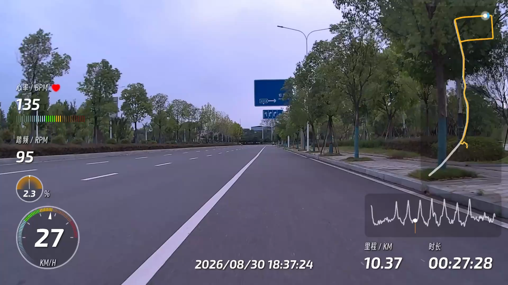

# ride-overlay

一个将 FIT/GPX 运动数据转换为骑行仪表盘视频的开源 Python 工具。既可以通过命令行生成透明或绿幕覆层素材，也可以在跨平台图形编辑器中直接预览骑行视频、调整仪表盘并导出带原视频音频的完整成片。



当前版本已支持：

- FIT 和 GPX 输入；
- 速度、里程、时长、当前时间、海拔、温度、气压、踏频、心率和功率；
- 坡度、累计爬升、消耗热量、标准化功率及速度/心率/踏频/功率的运行平均值；
- 完整路线、已完成路线和随运动方向旋转的当前位置轨迹仪表盘；
- 海拔曲线、线性/扇形裁剪进度、旋转指针和坡度水平仪；
- 按实时心率平滑改变透明度的心跳动画仪表盘；
- 全局背景图、前景图和透明度控制；
- 时间范围截取、平滑、线性插值和独立刷新间隔；
- 自定义字体、字号、九宫格对齐、颜色和模糊阴影；
- 静态图片预览；
- H.264/H.265 绿幕 MP4；
- 带 alpha 通道的 ProRes 4444 MOV；
- Windows、macOS、Linux 图形编辑器；
- 多段骑行视频的统一播放、定位和连接点显示；
- 自动识别相邻片段的重复画面，并在预览和导出中去除前一段末尾的重复帧；
- 编辑器预览播放源视频原声；
- 鼠标调整仪表盘位置、字号或宽度，并实时同步 `config.json`；
- 手动逐帧调整视频与运动数据的时间偏移；
- 将仪表盘直接合成到完整骑行视频，并保留源视频音频。

## 安装

推荐使用 Conda。项目需要 Python 3.11–3.13 和 FFmpeg：

```bash
conda env create -f environment.yml
conda activate ride-overlay
```

如果已经手动创建环境：

```bash
conda create --name ride-overlay python=3.13 pip ffmpeg -c conda-forge
conda activate ride-overlay
python -m pip install -e '.[dev,gui]'
```

确认安装：

```bash
ride-overlay --help
ride-overlay-editor --help
ffmpeg -version
```

## 使用

每次运行都需要传入一个项目目录：

```bash
ride-overlay /path/to/my-ride --preview
ride-overlay /path/to/my-ride
ride-overlay /path/to/my-ride --editor
```

也可以直接运行脚本：

```bash
python ride_overlay.py /path/to/my-ride --preview
```

项目目录应包含：

```text
my-ride/
├── config.json              必需，固定名称
├── activity.fit             FIT 或 GPX，必需
├── dashboard-font.otf       OTF、TTF 或 TTC，必需
├── dashboard-background.png 可选
├── new-arrow.png             可选，工程自定义当前位置图案
├── new-heart.png             可选，工程自定义心脏图案
├── 20260817072500_001.mp4    图形编辑器使用的第一段视频
├── 20260817073000_002.mp4    可选的后续视频片段
└── export/                   自动创建，存放所有生成结果
```

当运动文件或字体没有在配置中明确填写时，工具会按文件名排序选择目录中第一个匹配文件；存在多个候选时会打印警告。背景图或前景图留空表示不叠加对应图片。

仓库中的 [example_project](example_project) 是一个可以直接运行的完整范例，包含脱敏 FIT、Exo 2 字体、背景/前景图片和覆盖主要仪表盘类型的配置：

```bash
ride-overlay example_project --preview
```

范例没有附带源视频，`inputs.video_files`、视频连接信息和对齐偏移均处于初始状态。FIT 的轨迹已整体平移到虚构位置，时间轴已平移到固定示例日期，设备序列号和活动名称也已清理；运动时长及传感器曲线保持不变。Exo 2 字体依据随范例附带的 [SIL Open Font License 1.1](example_project/OFL.txt) 分发。

可以从 [config.example.json](config.example.json) 开始创建配置：

```bash
cp config.example.json /path/to/my-ride/config.json
```

## 配置

配置顶层包含以下内容：

- `opacity`：仪表盘背景图、所有仪表盘及前景图的全局透明度；
- `inputs`：运动文件、字体、仪表盘背景/前景 PNG 和可选视频列表；
- `clip`：相对于运动数据起点的开始、结束秒数；
- `timeline`：图形编辑器的视频/运动数据时间对齐信息；
- `output`：分辨率、帧率、背景模式和输出文件；
- `dashboards`：需要显示的指标及其格式和位置。

运动文件和字体可以使用 `null` 或空字符串表示自动选择。`inputs.video_files` 留空时，编辑器首次打开项目会扫描项目目录第一层，按包含数字的自然文件名排序，并把确定的视频列表写回 `config.json`；之后以配置中的顺序为准，也可以手工增删或调整：

```json
"video_files": [
  "20260817072500_001.mp4",
  "20260817073000_002.mp4"
]
```

`opacity` 的范围是 `0` 到 `1`，默认为 `1.0`。完整图层顺序是 `inputs.background_image_file`、配置顺序中的各仪表盘、`inputs.foreground_image_file`；三者完成内部合成后再统一乘到最终 alpha 上，因此全局透明度也会作用于前景图片，但不会改变它们之间的内部混色结果。

`inputs.foreground_image_file` 可以设为 `null` 或空字符串表示不使用。它只能写在 `inputs` 中；非空值必须是工程目录内的相对 PNG 路径。图片宽高比必须与输出分辨率一致，尺寸不同时会等比例缩放到输出尺寸。它适合放置表盘刻度、装饰边框或需要遮住指针和进度图形的前景元素。

`inputs.auto_fix_startup_altitude` 默认是 `true`。工具在运动开始后 60 秒内查找明显的海拔突跳，结合移动距离、气压和首次定位等证据，再用后续约 10 秒的读数确认海拔已经稳定。确认后仅将稳定前的海拔标为缺失，保留整条运动时间轴和其他指标。数字海拔显示 `-`，海拔曲线的圆点在首个可信采样前隐藏，累计爬升从清洗后的海拔计算（若运动文件已提供逐点累计值，则沿用该值）。排除范围和判据会记录到 `export/result.log`。设为 `false` 可使用原始海拔读数。

仓库的 `assets/images/` 提供所有图形仪表盘的默认 PNG，并提供 `dashboard-background.png`、`dashboard-foreground.png` 作为可复制修改的完整画面模板。背景和前景模板不会在配置留空时自动启用；范例工程在自身 `images/` 中保存副本，以满足工程资源必须位于工程目录内的路径安全规则。

`clip.start_seconds`、`clip.end_seconds` 同时留空表示完整运动范围。`clip` 只影响命令行的静态预览和覆层素材输出，图形编辑器始终使用完整运动数据和完整视频。命令行正式输出要求：

```text
0 <= start_seconds < end_seconds <= 运动总时长
```

`output.video_codec` 支持 `h264` 和 `h265`。范例配置默认使用压缩效率更高的 `h265` 和 `12 Mbps`；`output.video_encoder` 控制对应格式所用的编码器：

- `auto`（默认）：在 macOS 上先实际试编码一帧，确认可用后选择 VideoToolbox 硬件编码；否则使用 `libx264` 或 `libx265`；
- `videotoolbox`：强制使用 macOS VideoToolbox，不可用时明确报错；
- `software`：强制使用 `libx264` 或 `libx265`，适合更看重软件编码一致性、且可以接受较慢速度的场景。

三种模式都继续使用 `output.bitrate_mbps`。硬件编码与软件编码即使码率相同，画质和文件大小也可能略有差异。

图形编辑器打开 H.265 项目时会执行一次真实的单帧编码检测。若当前 FFmpeg 和设备无法按配置使用 H.265，编辑器会原子修改该项目的 `config.json`，回退为 `video_codec: "h264"`、`video_encoder: "auto"` 和 `bitrate_mbps: 16`，并在终端给出警告。旧项目中的 `h264_encoder` 仍可读取，但新配置应统一使用 `video_encoder`。

锚点以画面左上角为 `(0, 0)`、右下角为 `(1, 1)`。`align` 支持：

```text
top_left       top_center       top_right
middle_left    center           middle_right
bottom_left    bottom_center    bottom_right
```

颜色使用 `#RRGGBB` 或 `#RRGGBBAA`。字体大小、阴影偏移和模糊半径以输出视频像素为单位。
传统数字仪表盘的 `type` 可以省略，省略时等同于 `"type": "numeric"`；图形仪表盘需要明确填写其类型。

数字仪表盘不再提供文字描边。可选的 `shadow` 用于增加模糊阴影；设为 `null` 或省略表示不绘制阴影：

```json
"shadow": {
  "color": "#000000FF",
  "offset_x": 4,
  "offset_y": 4,
  "blur_radius": 6,
  "opacity": 0.75
}
```

`offset_x`、`offset_y` 可以为负数，分别表示阴影相对文字向右、向下偏移的输出像素数。`blur_radius` 范围是 `0` 到 `256`；`0` 表示保留清晰边缘，数值越大扩散越明显。`opacity` 范围是 `0` 到 `1`，会与 `color` 自身的 alpha 以及顶层全局 `opacity` 相乘。编辑器的选中矩形会包含阴影范围。渲染器按仪表盘缓存当前文字及阴影小图，相同显示值的连续视频帧不会重复执行模糊处理。

### 指标和单位

| `source` | 含义 | 可用单位 | 默认单位 |
| --- | --- | --- | --- |
| `speed` | 当前速度 | `km/h`、`m/s`、`mph` | `km/h` |
| `distance` | 当前累计里程 | `km`、`m`、`mi` | `km` |
| `elapsed_time` | 从运动数据起点经过的时长 | `hms` | `hms` |
| `current_time` | 当前运动记录对应的本地日期和时钟时间 | `hms`、`ymdhms` | `hms` |
| `altitude` | 当前海拔 | `m`、`ft` | `m` |
| `temperature` | 当前温度 | `C`、`F` | `C` |
| `pressure` | 当前气压 | `Pa`、`hPa`、`kPa`、`mmHg` | `hPa` |
| `cadence` | 当前踏频 | `rpm` | `rpm` |
| `heart_rate` | 当前心率 | `bpm` | `bpm` |
| `power` | 当前功率 | `W` | `W` |
| `grade` | 当前坡度 | `%` | `%` |
| `total_ascent` | 截至当前的累计爬升 | `m`、`ft` | `m` |
| `calories` | 截至当前的消耗热量 | `kcal` | `kcal` |
| `average_speed` | 截至当前的平均速度 | `km/h`、`m/s`、`mph` | `km/h` |
| `average_heart_rate` | 截至当前的平均心率 | `bpm` | `bpm` |
| `average_cadence` | 截至当前的平均踏频 | `rpm` | `rpm` |
| `average_power` | 截至当前的平均功率 | `W` | `W` |
| `normalized_power` | 截至当前的标准化功率（NP） | `W` | `W` |

`elapsed_time` 固定输出 `HH:MM:SS`。`current_time` 的 `unit` 为 `hms` 时也输出 `HH:MM:SS`，为 `ymdhms` 时输出 `YYYY/MM/DD HH:MM:SS`，例如 `2026/04/04 09:23:16`；两者的 `precision` 和 `pad_zeros` 均不会生效。`current_time` 使用运动记录的时间戳，并转换到运行工具的计算机本地时区，因此能够正确跨越午夜。其余指标只绘制数值，单位文字可放在仪表盘背景图片中。

### 数据来源和派生规则

`speed` 支持 `km/h`、`m/s` 和 `mph`。FIT 优先读取 `enhanced_speed`、其次读取 `speed`；缺少速度字段时尝试根据带时间戳的 GPS 点推导。GPX 通常采用 GPS 点推导速度。

瞬时速度可设置时间窗平滑：

```json
"smoothing": {
  "method": "moving_average",
  "window_seconds": 1.0
}
```

当前支持 `none` 和居中时间窗 `moving_average`。

`distance` 支持 `km`、`m` 和 `mi`。优先使用运动文件中的累计距离，否则根据 GPS 点累计；GPX 的不同 track segment 之间不会计算跳跃距离。

距离是累计型指标，不允许配置平滑。默认从整段活动起点累计；如需在截取起点归零：

```json
"cumulative_origin": "clip_start"
```

FIT 的海拔优先使用 `enhanced_altitude`。坡度优先读取运动文件的原始坡度；缺失时，工具先按 GPX segment 对海拔做 5 秒居中平滑，再在约 20 米距离窗口中按“高度变化 ÷ 水平距离 × 100”计算。移动距离不足 5 米时不生成坡度，避免停车状态下产生极端数值。

累计爬升不是终点与起点的海拔差。工具会对每个连续 segment 分别处理，将全部有效上升逐段加入累计值；默认使用 5 秒海拔平滑和 1 米高程消抖阈值，下降不会抵消已经获得的爬升。若运动文件直接提供了连续的累计爬升数据，则优先使用原始数据。

热量单位固定为千卡 `kcal`。优先使用逐点累计热量，其次使用 lap/session 汇总；某些 FIT 只保存全程总热量，这种情况下工具会在相邻汇总时刻间线性估算当前累计热量。

`average_speed`、`average_heart_rate`、`average_cadence` 和 `average_power` 是从运动起点到当前时刻的时间加权运行平均值。超过 5 秒的整段运动记录空洞不会加入平均值计算；空洞期间保持最后一个已经计算出的平均值，因此平均仪表盘不会消失。功率是一个例外：当该时刻存在运动记录但实时功率字段缺失时，`average_power` 会将它按 `0 W` 计算，以反映惯性滑行时没有做功。

`normalized_power` 使用实时功率按 1 Hz 计算：从第 30 秒开始，每秒计算此前 30 秒的平均功率，对这些滚动平均值取四次方，再对截至当前的全部四次方值求平均并开四次方根。它与 `average_power` 一样将有运动记录但缺失功率的时刻按 `0 W` 计算。整段记录空洞超过 5 秒时会中断 30 秒窗口，数据恢复后需要重新积累完整窗口。运动开始的前 30 秒不显示 NP；NP 对少于约 10 分钟的运动参考价值有限。

GPX 标准本身通常没有心率、踏频、功率、温度和气压。工具会识别常见 Garmin TrackPointExtension 以及按本地标签命名的 `hr`、`cadence`、`power`、`atemp`、`pressure`、`grade` 等扩展；文件未提供的指标会警告并跳过。

### 轨迹仪表盘

轨迹仪表盘使用运动文件中的经纬度显示完整路线、截至当前时刻的已完成路线和当前位置。示例：

```json
{
  "type": "trajectory",
  "id": "route",
  "width": 0.3,
  "margin": 0.02,
  "anchor": {"x": 0.95, "y": 0.05},
  "align": "top_right",
  "update_interval_ms": 200,
  "line_width": 8,
  "remaining_color": "#FFFFFF66",
  "completed_color": "#00E676CC",
  "overlap_blend_mode": "uniform",
  "background_color": null,
  "background_corner_radius": 24,
  "shadow": {
    "color": "#000000FF",
    "offset_x": 4,
    "offset_y": 4,
    "blur_radius": 6,
    "opacity": 0.75
  },
  "marker_image_file": null,
  "marker_scale": 2.0
}
```

`width` 是整个轨迹仪表盘外接矩形宽度占输出画面宽度的比例，范围为 `(0, 1]`。轨迹中心线缩放前会从矩形内部扣除线宽和当前位置图片旋转后的最大半径。`margin` 是相对于仪表盘外接矩形宽高的留白比例，可设为 `-0.25` 到 `0.25`，默认 `0.02`：正值使轨迹和箭头向矩形内收，负值则允许它们超出矩形。负边距造成的视觉溢出不会被提前裁掉；编辑器紫色虚线框与可选背景仍使用原始仪表盘矩形。高度根据等距投影后的轨迹宽高比、视觉半径及边距自动计算。更改输出分辨率时轨迹占画面宽度的比例不变。如果计算出的高度或锚点位置超出画面，工具会在终端和 `result.log` 中警告，但不会擅自缩小仪表盘。`width` 小到无法容纳线宽、箭头和正边距时会明确报错。

`background_color` 设置可选的圆角矩形背景，使用 `#RRGGBB` 或 `#RRGGBBAA`；设为 `null` 或留空时不绘制背景。`background_corner_radius` 是输出像素单位的圆角半径，背景尺寸正好等于上述仪表盘外接矩形。

`shadow` 为可选的完整轨迹阴影，省略或设为 `null` 时不绘制。其 `color`、`offset_x`、`offset_y`、`blur_radius` 和 `opacity` 与数字仪表盘文字阴影的语义及取值范围一致，偏移和模糊半径均以输出像素为单位。阴影直接复用完整轨迹的抗锯齿蒙版，并缓存平移、着色和模糊后的静态图层，不会在每次轨迹进度刷新时重复执行模糊。阴影可以超出仪表盘矩形，但超出最终画面的部分会被裁切。

轨迹仪表盘从底层到顶层固定按以下顺序合成：可选背景矩形、可选完整轨迹阴影、完整轨迹、已完成轨迹、当前位置图片。

轨迹固定为上北下南。当前位置图片的默认资源为项目仓库中的 `assets/images/arrow.png`，图片默认朝上；渲染时会旋转到同一连续轨迹段中的下一个不同位置点。`marker_scale` 是相对于图片原始像素尺寸的缩放倍数。需要覆盖默认图案时，将 PNG 放在当前工程目录中，并将 `marker_image_file` 写成相对于工程目录的路径，例如 `"new-arrow.png"`；绝对路径及指向工程目录外的 `..` 路径会被拒绝。

位置记录超过 5 秒的空洞、GPX track segment 切换和明显不可信的位置跳跃都不会被直线连接。空洞期间，箭头停留在最后一个可靠位置并保持最后的可靠朝向，位置恢复后再跳到恢复点。已完成轨迹始终从整段运动的起点计算，不受视频截取起点影响。

用于绘图的中心线会以 `line_width` 的约 10%（最低 0.5 像素）为容差移除肉眼不可分辨的 GPS 微小抖动，同时强制保留折返点；原始轨迹数据、当前位置和统计计算不受影响。轨迹和背景蒙版最多以 4 倍分辨率绘制后缩小，从而让粗线边缘保持平滑。

两种轨迹颜色都支持 alpha。为兼容已有配置，完整轨迹底色仍使用 `remaining_color` 这个字段名，但它现在表示“完整轨迹颜色”：完整轨迹始终绘制，并始终位于已完成轨迹下方。这样已完成部分不会替换或移除底层，轨迹的整体轮廓和基础透明度在整个视频中保持稳定。

`overlap_blend_mode` 有两种模式：

- `"uniform"`（默认）为完整轨迹和已完成轨迹分别生成统一覆盖蒙版，每种颜色只应用一次；圆角、端点和自重叠不会局部变深。
- `"accumulate"` 在最终渲染像素域内统计独立经过次数。移动轨迹的带线宽区域连续覆盖同一像素时只算一次；离开后再次覆盖才增加一次，并将 `completed_color` 再混合一层。因此折返路线在第二、第三次完成后会逐次加深，同时相邻线段接头不会产生色斑。

`accumulate` 反映的是当前缩放比例和 `line_width` 下可见线条的重叠，不是地图道路拓扑：空间上接近到足以覆盖同一像素的平行道路也会被视为重叠，高架与地面道路交叉也无法仅凭二维位置区分。该模式会在首次渲染轨迹时进行一次像素覆盖预计算，复杂轨迹的启动时间和内存占用会高于 `uniform`。

### 海拔曲线仪表盘

海拔曲线仪表盘以完整活动时间为横轴、海拔为纵轴绘制全程曲线，并用圆点和向下的竖线表示当前时刻。它不绘制坐标刻度、轴线文字或单位标签。

```json
{
  "type": "elevation_profile",
  "id": "elevation_profile",
  "width": 0.4,
  "height": 0.2,
  "margin": 0.03,
  "anchor": {"x": 0.5, "y": 0.95},
  "align": "bottom_center",
  "update_interval_ms": 200,
  "line_color": "#FFFFFFFF",
  "line_width": 6,
  "curve_smoothing": 0.6,
  "dot_color": "#00E676FF",
  "dot_size": 16,
  "vertical_line_color": "#FFFFFF99",
  "vertical_line_width": 2,
  "background_color": "#00000066",
  "background_corner_radius": 24
}
```

`width` 是仪表盘外接矩形占输出画面宽度的比例，`height` 是其占输出画面高度的比例。背景圆角矩形正好使用这个外接矩形。曲线、圆点和竖线的尺寸使用输出像素；工具会从外接矩形中扣除最大笔画半径和抗锯齿空间，再计算实际曲线区域，因而默认不会让粗线或大圆点越过背景边缘。尺寸太小、无法容纳这些视觉元素时会明确报错。

`margin` 范围为 `[-0.25, 0.25]`，默认 `0.02`。正值按外接矩形宽、高分别向内增加留白，负值允许曲线和当前位置图形超出外接矩形；负边距造成的溢出会记录到日志，但不会自动缩小。编辑器拖动缩放时会同时等比例修改 `width` 和 `height`。

纵轴上限是全程最高海拔，下限按照 `最低海拔 - (最高海拔 - 最低海拔) × 0.2` 计算。因此最低海拔曲线下方仍留有空间，当前位置竖线始终可以从圆点延伸到绘图区底边。当全程海拔完全相同时，为避免纵轴范围为零，下限改用该海拔减 1 米。

曲线使用圆角笔画并进行抗锯齿绘制。`curve_smoothing` 是范围为 `[0, 1]` 的无单位曲线平滑强度，默认 `0`：`0` 完全保留原始折线；数值越大，短时间海拔波动和尖锐转角被平滑得越明显。最大值 `1` 使用相当于完整活动时长 `2%` 的居中时间窗，例如一小时活动对应 72 秒；`0.5` 对应完整时长的 `1%`。该换算以图表横轴比例为基准，因此不会因 FIT/GPX 的采样频率不同而显著改变视觉效果。

平滑按每段连续海拔数据分别计算，不会跨越数据空洞，也不会改变整段曲线的起点和终点；当前位置圆点使用同一条平滑曲线，因此始终落在曲线上。该参数只改变图表视觉曲线，不会修改其他海拔、坡度或累计爬升仪表盘的数据。实际时间窗口和所用算法会写入任务报告。

`dot_size` 表示圆点直径。`vertical_line_width` 表示最终输出分辨率中的实际像素宽度；竖线会与输出像素网格对齐，始终严格占用指定数量的像素列，避免它随圆点经过不同亚像素位置时产生视觉宽度变化。横轴始终覆盖完整运动数据，不受命令行 `clip` 范围影响；`clip` 只决定当前圆点所在的时间。超过数据插值阈值的海拔空洞不会被直线连接，空洞期间圆点停留在最后一个可靠曲线点，直到数据恢复。

当全程采样点远多于实际横向像素时，每个像素列会保留时间首尾点以及海拔最高、最低点，在控制绘制成本的同时保留可见尖峰。缺少至少两个有效海拔点时，该仪表盘会记录警告并跳过。

### 心跳动画仪表盘

心跳动画仪表盘使用当前心率控制一张心脏图片的透明度循环：每次循环按照平滑的余弦曲线完成 `1 → 0 → 1`，循环时长为 `60 ÷ 当前心率` 秒。例如 120 bpm 对应 0.5 秒完成一次完整透明度循环。

```json
{
  "type": "heartbeat",
  "id": "heartbeat",
  "width": 0.08,
  "anchor": {"x": 0.1, "y": 0.5},
  "align": "center",
  "heart_image_file": null
}
```

`width` 是图片宽度占输出画面宽度的比例，范围为 `(0, 1]`；图片高度根据原图宽高比自动计算，不需要配置缩放比例。`anchor` 和 `align` 的含义与其他仪表盘一致。默认图片为 `assets/images/heart.png`，也可以将自定义 PNG 放入当前工程，并在 `heart_image_file` 中填写相对于工程目录的路径。绝对路径和指向工程外的路径会被拒绝。

为了避免瞬时心率大幅变化造成动画跳动，当前循环期间不会改变速度；只有当透明度重新回到 1、一个完整循环结束时，才读取该时刻的心率并设置下一循环速度。因此循环边界上的透明度和变化方向保持连续。心率数据短暂缺失时沿用上一个有效循环频率；动画开始后尚未获得有效心率时，图片保持完全不透明。

心跳动画每一视频帧都会更新，不使用 `update_interval_ms`。在 `--preview` 模式下图片始终以原图完整透明度渲染，即使预览时刻刚好处于心率数据空洞中，也能准确检查其大小和位置。

### 裁剪进度条仪表盘

裁剪进度条用当前指标值逐步显示一张图片，可用于心率、功率、速度等数值。`min_value` 对应图片完全被裁剪，`max_value` 对应图片完整显示；低于或高于范围的数值会分别限制为 0% 和 100%。示例：

```json
{
  "type": "fill_progress",
  "id": "heart_rate_progress",
  "source": "heart_rate",
  "unit": "bpm",
  "smoothing": {
    "method": "moving_average",
    "window_seconds": 1.0
  },
  "update_interval_ms": 100,
  "width": 0.18,
  "anchor": {"x": 0.1, "y": 0.6},
  "align": "middle_left",
  "min_value": 80,
  "max_value": 180,
  "direction": "left_to_right",
  "clip_granularity": 0,
  "image_file": null
}
```

`direction` 表示图片随数值增大而显现的方向，支持 `left_to_right`、`right_to_left`、`bottom_to_top` 和 `top_to_bottom`。裁剪不会拉伸或移动已经显示的部分。阈值使用 `unit` 指定的单位，例如速度使用 `km/h` 时，两个阈值也按 km/h 填写。`smoothing` 和 `update_interval_ms` 的规则与数值仪表盘一致。

`clip_granularity` 控制裁剪比例的离散化步进，范围为 `[0, 0.5]`。例如设为 `0.3` 时，只会出现 `0%`、`30%`、`60%`、`90%` 和 `100%` 五种状态：大于前一档且不超过后一档的预期比例会向上取到后一档。设为 `0` 时关闭离散化；如果该值小于沿裁剪方向一个渲染像素所占的比例（横向为 `1 ÷ 渲染宽度`，纵向为 `1 ÷ 渲染高度`），也按未离散化处理。

`width` 是图片宽度占输出画面宽度的比例，图片高度根据原图宽高比自动计算；`anchor` 和 `align` 控制完整图片矩形的位置。默认资源为 `assets/images/fill_progress_bar.png`。需要覆盖时，可将自定义 PNG 放入工程目录，并在 `image_file` 中填写相对于工程目录的路径。数据在当前时刻缺失时不绘制进度条，但编辑器仍保留完整图片矩形作为选择和缩放区域。

图片尺寸、锚点和指标采样由图片型数值仪表盘的公共配置与布局层处理；本进度条与下面的角度进度盘共用这一层，只采用不同的图像裁剪方式。

### 角度旋转裁剪进度盘

角度进度盘同样由当前指标值逐步显示一张图片，但显示区域是从配置圆心展开的扇形。图片不要求为正方形，也不会被拉伸成正方形；扇形范围会覆盖图片四角。示例：

```json
{
  "type": "radial_progress",
  "id": "power_dial",
  "source": "power",
  "unit": "W",
  "smoothing": {
    "method": "moving_average",
    "window_seconds": 1.0
  },
  "update_interval_ms": 100,
  "width": 0.12,
  "anchor": {"x": 0.9, "y": 0.6},
  "align": "center",
  "min_value": 0,
  "max_value": 400,
  "start_angle": 225,
  "angle_range": 270,
  "clip_granularity": 0,
  "center": {"x": 0.5, "y": 0.5},
  "image_file": null
}
```

`start_angle` 以 12 点钟方向为 `0°`，角度沿顺时针增加，因此 `90°` 是 3 点钟方向；有效范围为 `[0, 360]`，其中 `360°` 与 `0°` 方向相同。`angle_range` 的绝对值范围为 `(0, 360]`，不得为 `0`：正值从起始角度顺时针展开，负值逆时针展开。例如 `180` 在达到 `max_value` 时显示图片的一半，`-270` 则逆时针显示四分之三。

`min_value` 对应 `0°`，`max_value` 对应完整的 `angle_range`，范围外仍限制为 0% 和 100%。`clip_granularity` 使用整个角度范围的百分比，而不是角度数值；例如粒度为 `0.3`、角度范围为 `70°` 时，状态为 `0°`、`21°`、`42°`、`63°`、`70°`。最后不足一个完整步进的部分会直接收束到配置的最大角度。

`center` 指定扇形圆心在原始图片矩形中的相对位置，左上角为 `0/0`、右下角为 `1/1`，两个分量的范围均为 `[0, 1]`；默认 `0.5/0.5`，即图片的几何中心。圆心位于边缘或角落时，扇形半径会自动扩展到足以覆盖图片最远的角，不会把非正方形图片强制转换为正方形。

粒度为 `0` 时使用连续角度。如果粒度造成的外缘角位移小于一个渲染像素，也按连续角度处理。离散状态的扇形蒙版会缓存复用，缓存数量有固定上限；连续模式不会保留逐帧产生的蒙版，以避免长视频预览或导出时内存持续增长。

其余 `source`、`unit`、`smoothing`、`update_interval_ms`、`width`、`anchor`、`align` 和 `image_file` 的含义与裁剪进度条相同。默认资源为 `assets/images/sector_fill_progress_bar.png`；也可以在工程目录中提供自定义透明 PNG，并通过 `image_file` 覆盖。

### 旋转仪表盘

旋转仪表盘根据当前指标旋转整张图片，适合制作速度计、功率表等仪表的指针，也可以与角度进度盘使用相同的 `anchor`、`align`、数值范围和角度范围叠加显示。两张素材宽高比不同时，应分别设置 `width`，让它们渲染后的实际尺寸相匹配。

```json
{
  "type": "rotation",
  "id": "power_needle",
  "source": "power",
  "unit": "W",
  "smoothing": {
    "method": "moving_average",
    "window_seconds": 1.0
  },
  "update_interval_ms": 100,
  "width": 0.015,
  "anchor": {"x": 0.9, "y": 0.6},
  "align": "center",
  "min_value": 0,
  "max_value": 400,
  "start_angle": 225,
  "angle_range": 270,
  "clip_granularity": 0,
  "center": {"x": 0.5, "y": 0.5},
  "image_file": null
}
```

图片未旋转时的朝向视为 `0°`。数据等于 `min_value` 时旋转到 `start_angle`，等于 `max_value` 时旋转到 `start_angle + angle_range`；正角度顺时针、负角度逆时针，范围外数值仍限制在两个端点。`start_angle`、`angle_range` 和 `clip_granularity` 的范围与角度进度盘相同。

`center` 是旋转枢轴在未旋转图片中的相对位置，默认是几何中心。渲染时枢轴在画面中的位置保持不动，并为图片四角预留完整旋转空间，因此中心靠近图片边缘、图片宽高不同或旋转角度较大时也不会在仪表盘内部被裁掉。编辑器的紫色选择框使用能够覆盖所有角度的最大旋转范围，所以可能大于未旋转图片矩形；超出视频画面时会记录警告，但不会自动缩小。

离散化启用时只缓存有限数量的旋转结果；连续旋转不会缓存每一帧。默认图片为 `assets/images/sector_pointer.png`，可以通过工程内的 `image_file` 换成其他指针 PNG。自定义图片在 `0°` 时通常应让指针朝向 12 点钟方向。

### 坡度水平仪

坡度水平仪使用当前坡度旋转一张图片，用来直观表现道路的真实倾斜角度。图片按照 `width` 等比缩放，并始终围绕图片的几何中心旋转。

```json
{
  "type": "grade_level",
  "id": "grade_level",
  "width": 0.08,
  "anchor": {"x": 0.5, "y": 0.85},
  "align": "center",
  "update_interval_ms": 100,
  "angle_smoothing_seconds": 0.5,
  "image_file": null
}
```

旋转角度不是直接使用坡度百分比，而是按照 `degrees(atan(坡度百分比 / 100))` 换算为真实倾角。例如 `100%` 坡度对应 `45°`，`10%` 坡度约对应 `5.71°`。正坡度使图片右侧向上倾斜，负坡度使右侧向下倾斜。

`angle_smoothing_seconds` 是对换算后的倾角使用的居中平滑时间窗，范围为 `[0, 3600]` 秒，默认 `0.5`；设为 `0` 时关闭平滑。平滑在角度换算后进行，不会跨越原始坡度数据空洞，因此编辑器随机定位、正常播放和最终导出在同一时刻会得到相同角度。数据空洞期间暂时隐藏图片。

默认图片是 `assets/images/level.png`。可以把自定义 PNG 放入工程目录，并通过 `image_file` 填写相对于工程目录的路径。旋转会为图片四角预留完整范围；紫色选择框表示这个稳定的最大旋转范围，因此会略大于图片未旋转时的矩形。

### 刷新和插值

`update_interval_ms` 控制数字多久变化一次，与视频 FPS 相互独立。刷新时刻落在相邻原始采样点之间且间隔不超过 5 秒时使用线性插值，两个刷新时刻之间保持上一个显示值。

数据空洞按指标类型处理：

- 速度、踏频、心率、功率等瞬时指标在超过 5 秒的空洞中显示 `-`，避免用过时数据冒充实时值；
- 平均指标忽略缺失区间，并保持最后一个已经计算出的平均值；
- 里程、累计爬升、热量等累计指标不会因空洞消失：连续采样中断时保持已有结果；只有汇总数据时按前述热量等指标的估算规则更新。

## 预览模式

```bash
ride-overlay my-ride --preview
```

预览模式会：

1. 检查配置、输入文件和各仪表盘是否可用；
2. 在目录中按文件名选择第一个视频；
3. 提取视频中间帧作为底图；
4. 使用相对于截取起点相同秒数的运动数据；
5. 输出 `export/preview.png`。

没有视频时，使用截取运动范围的中点数据和输出背景。运动文件中不可用的指标会产生警告并被跳过，不会阻止其他指标预览。

## 图形编辑器

```bash
ride-overlay my-ride --editor
# 或
ride-overlay-editor my-ride
```

编辑器将项目目录中的多段视频视为一条连续时间轴。视频按输出分辨率等比缩放，比例不一致时使用黑边填充，不会拉伸。蓝色轨道表示视频范围，黄色圆点表示片段连接点，绿色轨道表示运动数据映射到视频后的范围；在两条轨道所在区域点击或拖动都可以定位视频，且不会改变播放/暂停状态。

预览画布提供“适应窗口 / 原始分辨率”切换按钮。适应窗口模式显示完整输出画面；原始分辨率模式采用 1:1 画布比例，超出窗口的部分可通过滚动条查看，适合检查单像素线条等容易受缩放插值影响的细节。该切换只改变编辑器显示比例，不修改配置，也不影响导出分辨率。

当前时间和视频总时长使用 `HH:MM:SS:FF` 格式显示，帧号按 `output.fps` 计算。除界面上的播放按钮和时间轴定位外，还支持以下键盘操作：

- `Space`：播放或暂停；
- `←`：暂停视频，并回退一个输出帧；
- `→`：暂停视频，并前进一个输出帧。

播放按钮右侧的倍速按钮显示为“当前倍速 X”。每次点击依次在 `1×、2×、3×、5×、10×、0.5×` 之间循环，初始为 `1×`。倍速同时作用于预览画面和原声，只在本次编辑器运行期间有效，不会写入 `config.json`。

`timeline.activity_start_offset_frames` 表示运动数据起点位于视频时间轴中的帧位置，正数表示运动数据比视频晚开始，负数表示运动数据更早开始。左右对齐按钮短按调整一帧，长按连续调整。偏移使用 `output.fps` 作为帧率基准：

```json
"timeline": {
  "activity_start_offset_frames": 4979,
  "video_joins": [
    {
      "previous_file": "20260817072500_001.mp4",
      "next_file": "20260817073000_002.mp4",
      "overlap_frames": 15
    }
  ]
}
```

编辑器首次发现某个相邻片段连接尚未配置时，会读取前一段结尾和后一段开头最多约 3 秒的缩小灰度画面，先查找完全相同的帧序列，再进行保守的近似匹配。匹配只使用视频内容，不使用音频波形、文件时间或相机元数据。每个结果连同置信度、画面特征和候选信息写入 `export/video-analysis.log`；解码结果摘要缓存在 `export/.video-analysis-cache.json`，素材没有变化时不会重复分析。

`timeline.video_joins[].overlap_frames` 表示从该连接处前一个视频末尾忽略的帧数。该值会同时影响预览时间轴和最终导出；音频也在相同时间边界裁切，但不参与重复帧判断。配置中的值始终优先，用户可以手工修正，编辑器检测到有效的外部修改后会立即重建时间轴。自动 fallback 只会修正“明显偏离稳定主簇、置信度又低、且非零”的结果；不会用其他连接处的平均值填补可靠的 0 帧结果。

暂停时点击仪表盘可以选中它；开始播放会清除选择，播放过程中点击仪表盘则先暂停再选中。选中态显示紫色虚线边框和位于锚点的移动控件：

- 拖动移动控件修改 `anchor.x/y`；
- 拖动仪表盘矩形的其他位置修改数字仪表盘的 `font_size`，或图形仪表盘的 `width`；
- 锚点和宽度写入配置时最多保留三位小数；
- 配置采用约 80ms 防抖和原子替换写入；
- 外部编辑器保存有效的 `config.json` 后，图形界面会自动更新；暂时无效的 JSON 不会覆盖最后一次有效预览，也不会被 GUI 反向覆盖。

移动或缩放仪表盘时，编辑器会立即更新锚点控件和紫色虚线框，但不会在每个鼠标移动事件中重建整张仪表盘覆层。鼠标停稳约 150ms 或松开按键后，才会合并写入最新几何参数并实际重新渲染；连续拖动过程中画面里的旧仪表盘暂时保持原位，以减少复杂轨迹、图表和旋转图片造成的交互卡顿。

“导出完整视频”使用 `output` 中的文件名、分辨率、帧率、码率、视频格式和编码器设置，将每个源视频按 `video_joins` 独立裁切画面和音频、等比适配后再拼接，最后直接合成仪表盘。这样不会依赖关键帧位置来决定接缝，也不会把已删除的尾部声音带到下一片段。成片使用 H.264 或 H.265 视频和 AAC 音频，包含源视频音轨；H.265 MP4 会写入兼容 Apple 平台的 `hvc1` 标签。底层视频在合成链路中保持 YUV 420，避免先转成全分辨率 RGBA 再转回；macOS 默认使用经过试编码确认的 VideoToolbox 硬件编码。`output.background` 只对下面的命令行覆层输出生效，图形编辑器不会把绿幕或透明底色叠加进成片。当前版本要求所有视频都包含音轨或都不包含音轨；混合情况会明确报错。

macOS 导出期间会启动一个随 FFmpeg 进程自动结束的 `caffeinate -i` 保护，防止系统因空闲自动睡眠而中断长任务；它不会阻止合盖、关机或用户主动执行睡眠。`export/result.log` 会记录实际编码器、是否启用硬件编码与防休眠、导出耗时及“视频时长 / 导出耗时”速度倍率。

多段视频的输出帧数按每段有效时长分别取最接近的帧数后相加，避免 MP4 容器时长的小数舍入在总时间轴末尾多生成一帧。若 FFmpeg 在最后极少数舍入帧处正常结束，导出会按成功收尾；真正的提前退出则会在报告中保留退出码、stderr、已提交/剩余帧数、临时文件大小、剩余磁盘空间和完整 FFmpeg 参数。

图形编辑器播放视频时会同时播放源视频原声。暂停状态跨片段定位时，播放器仅在内部短暂静音解码目标画面，完成定位后会恢复声音，不会改变用户的播放/暂停状态。

## 命令行覆层输出模式

`output.background.mode` 决定编码方式：

| 模式 | 默认文件 | 视频编码 | 用途 |
| --- | --- | --- | --- |
| `chroma_key` | `overlay.mp4` | H.264 或 H.265/yuv420p | 文件较小，在剪辑软件中抠除绿色 |
| `transparent` | `overlay.mov` | ProRes 4444/yuva444p10le | 直接保留 alpha，文件可能很大 |

普通 H.264/H.265 MP4 不保存透明通道，因此透明模式只接受 `.mov`，绿幕模式只接受 `.mp4`。显式配置不匹配的扩展名会报错，而不会静默丢失 alpha。

视频先写入 `export/` 中的临时文件，编码成功后再原子替换最终输出，避免失败时留下半成品或破坏上一次成功结果。`output.filename` 现在相对于 `export/` 解析；旧版本留在项目根目录中的生成文件不会被自动移动或删除。

## 工作结果日志

每次命令行执行和图形编辑器成片导出都会生成一份 UTF-8 编码的 `export/result.log`。即使任务在输入路径解析前失败，也会尽量在 `export/` 中留下报告。日志采用临时文件加原子替换的方式写入，每次运行覆盖上一份报告，使内容始终对应当前输出结果。

视频拼接分析另行生成 `export/video-analysis.log`，在打开图形编辑器、完成项目载入时即可阅读，不必等到导出。它记录视频扫描顺序、每段元数据、每个连接的配置值和自动分析值、置信度、匹配指标、警告、fallback 原因、总裁切时长及有效时间轴时长。

报告包括：

- 唯一运行 ID、程序版本、模式、命令、运行环境、最终状态和退出码；
- 每个处理阶段的开始/结束时间、耗时和成功/失败状态；
- 完整配置快照、已解析的输入/输出文件及文件大小；
- 运动记录数量、运动起止时间、总时长，以及每项指标的数据来源、样本数量、缺失数量、覆盖率、数值范围和覆盖范围；
- 每个仪表盘的启用或跳过状态、平滑与刷新设置、数据空洞的起止时刻、长度和处理策略；轨迹还会记录有效/缺失/过滤点数、分段与断点、投影外接矩形、缩放、实际矩形、越界方向及箭头资源；心跳动画会记录图片尺寸、实际渲染矩形、动画曲线、相位起点、循环速度更新策略和心率空洞；
- 预览源视频与抽帧时刻，或输出视频的编码器、帧数、分辨率、FPS 和文件大小；
- 本次任务的全部 INFO、WARNING、ERROR 以及详细 DEBUG 事件。

终端是否显示 DEBUG 信息仍由 `--verbose` 控制，但 `result.log` 始终记录详细事件。报告可能包含本地路径、运动时间和素材文件名，分享前请检查隐私信息。

## 开发

```bash
conda activate ride-overlay
python -m pytest
ruff check .
```

核心代码按职责拆分为以下模块：

- [ride_overlay.py](ride_overlay.py)：配置加载、工程文件解析、任务报告、预览/视频编码和 CLI 编排；
- [ride_overlay_data.py](ride_overlay_data.py)：FIT/GPX 读取、统一数据模型、位置清洗与投影、插值、统计及派生指标；
- [ride_overlay_dashboard.py](ride_overlay_dashboard.py)：数字/轨迹/心跳动画仪表盘配置、空洞策略、数值格式化、采样和 Pillow 绘制。
- [ride_overlay_video.py](ride_overlay_video.py)：视频扫描、FFprobe 元数据和多片段虚拟时间轴；
- [ride_overlay_video_analysis.py](ride_overlay_video_analysis.py)：视频重复帧分析、缓存、配置补全和独立报告；
- [ride_overlay_export.py](ride_overlay_export.py)：完整视频、透明仪表盘层及源音轨的 FFmpeg 合成；
- [ride_overlay_ffmpeg.py](ride_overlay_ffmpeg.py)：H.264/H.265 编码器选择、能力探测和 macOS 防休眠；
- `ride_overlay_gui/`：Qt 播放器、画布交互、双层时间轴、配置同步和后台导出。

`ride_overlay.py` 会继续转发原有的公共类型和函数，因此现有的 Python 导入方式保持兼容。这一边界也为后续增加轨迹、曲线等图形仪表盘提供独立扩展位置。

真实 FIT/GPX 可能包含精确时间、GPS 轨迹、设备标识和活动名称，原始骑行视频也很大。仓库默认忽略任意位置的 FIT/GPX 与常见视频格式，只对白名单中的脱敏范例 FIT 例外；请勿放宽这些规则来提交临时测试素材。

## License

GNU General Public License v3.0，详见 [LICENSE](LICENSE)。
